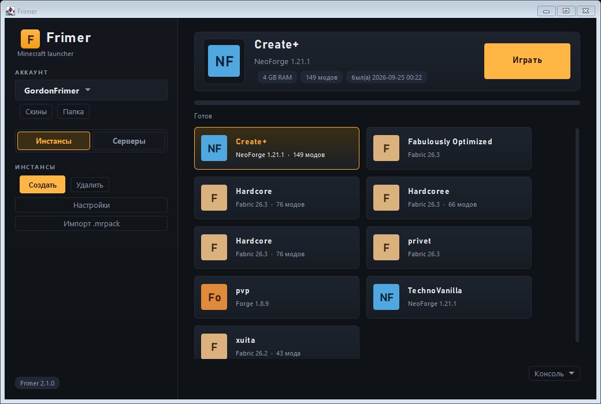
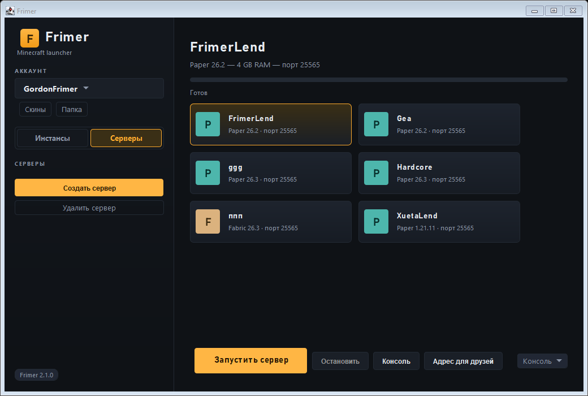
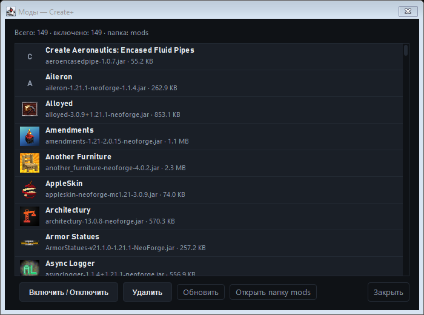
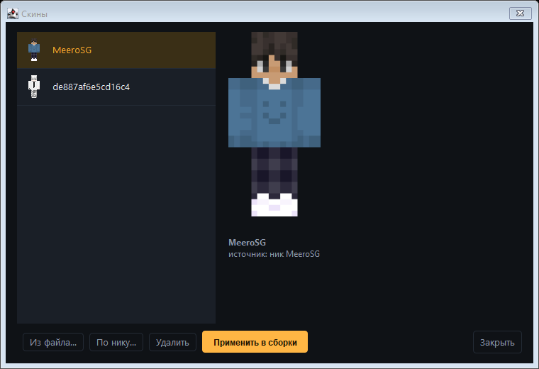
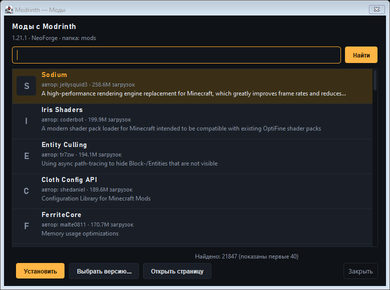
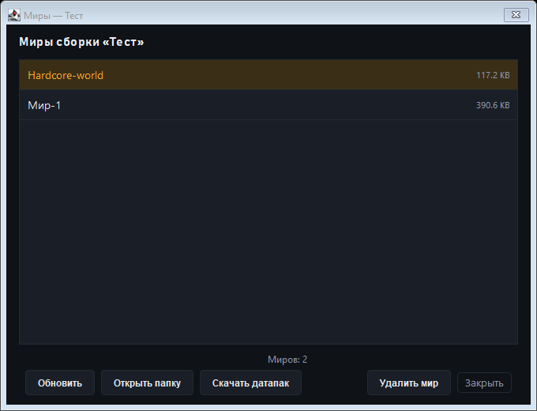
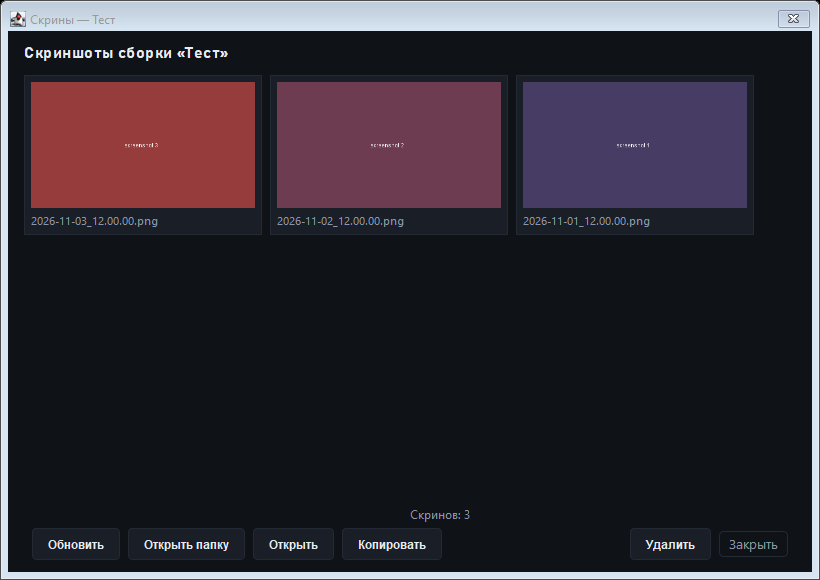
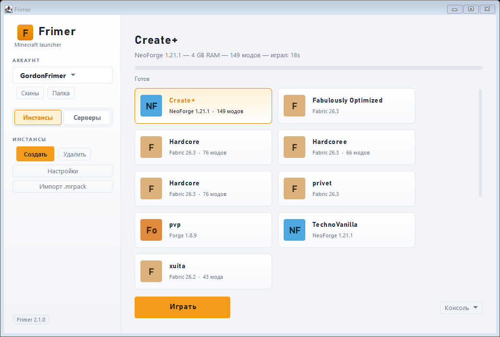

# Frimer Launcher (Java)

Minecraft-лаунчер, переписанный с Python (PyQt6) на **Java + Swing** без единой внешней зависимости.
Запускает Vanilla, Fabric, Quilt, Forge и NeoForge, держит сервера, скины и моды,
сам скачивает нужную версию Java и умеет импортировать сборки Modrinth.



## Возможности

**Клиент**
- Сборки (инстансы): создание, редактирование, дублирование, удаление, своя иконка и статистика игры.
- Загрузчики: **Vanilla, Fabric, Quilt, Forge, NeoForge** — установка в один клик, с выбором версии загрузчика.
- Автоустановка **Java** (Eclipse Temurin через Adoptium API): JRE/JDK нужного мажора, zip и tar.gz.
- Сборка команды запуска по-честному: правила ОС, `inheritsFrom`, аргументы JVM/игры, `natives`, classpath.
- Импорт сборок **Modrinth (.mrpack)** перетаскиванием файла на окно.
- Браузер **Modrinth**: поиск модов/шейдеров/ресурспаков/датапаков, выбор версии,
  установка с обязательными зависимостями и проверкой SHA.
- **Миры**: размер мира, открытие папки, датапаки с Modrinth, удаление.
- **Скриншоты**: галерея с превью (новые сверху), открытие, копирование в буфер, удаление.
- **Разбор крашей**: причина, подсказки по частым проблемам (RAM, Mixin, Java, драйверы) и текст отчёта.
- Консоль игры прямо в окне, принудительное закрытие процесса вместе с дочерними.

**Сервера**
- Ядра: **Paper, Vanilla, Fabric, Forge, NeoForge** — установка через официальные API и инсталляторы.
- `eula.txt` и `server.properties` создаются/обновляются автоматически.
- Живая консоль, «Остановить» (команда `stop`) с автопринудительным завершением через 15 с.
- **playit.gg** подхватывается или скачивается сам, адрес для друзей ловится из лога и копируется в буфер.

**Оформление и мелочи**
- Тёмная и светлая темы, свои скруглённые карточки и бейджи загрузчиков.
- Скины: библиотека, загрузка по нику с Mojang, превью «вид спереди» (Java2D), экспорт в `CustomSkinLoader`.
- Моды: список с названиями и иконками из `fabric.mod.json` / `quilt.mod.json` / `mods.toml`, включение и удаление.
- Свои JSON-парсер и сериализатор, скачивание с докачкой и проверкой SHA-1/SHA-512.

| Клиент | Сервера | Моды | Скины |
|---|---|---|---|
|  |  |  |  |

| Браузер Modrinth | Миры | Скриншоты |
|---|---|---|
|  |  |  |

Светлая тема:

| Светлая тема |

|---|

|  |

## Требования

- **JDK 17 или новее** (`javac` и `java` в PATH). Внешние библиотеки не нужны.
- Windows, Linux или macOS (интерфейс и установщики рассчитаны в первую очередь на Windows).

## Сборка и запуск

Windows:

```bat
build.bat
run.bat
```

Вручную:

```bash
javac -encoding UTF-8 -d build/classes $(find src/main/java -name "*.java")
jar cfe build/FrimerLauncher.jar com.frimer.launcher.Main -C build/classes .
java -jar build/FrimerLauncher.jar
```

Через Maven (если установлен):

```bash
mvn -q package
java -jar target/FrimerLauncher.jar
```

## Где лежат данные

Папка та же, что у Python-версии, — существующие сборки, сервера и настройки подхватываются сразу:

```
~/.mylauncher/            (C:\Users\<имя>\.mylauncher)
├── instances/            сборки клиента (instance.json, mods/, resourcepacks/, saves/)
├── servers/              сервера (server.json, world/, mods/, plugins/)
├── versions/             версии и профили загрузчиков
├── libraries/  assets/   библиотеки и ресурсы Minecraft
├── runtime/              скачанные JRE/JDK и инсталляторы
├── skins/                библиотека скинов
└── cache/
```

Настройки (ник, тема, память) хранятся в реестре Windows через `java.util.prefs` — раздел `com/frimer/launcher`.

## Структура проекта

```
src/main/java/com/frimer/launcher/
├── Main.java                 точка входа
├── core/                     вся логика без UI
│   ├── Json, Utils, Dirs, Http, Downloader, Archives
│   ├── Mojang, Loaders, Rules, LaunchBuilder
│   ├── JavaProvisioner, VanillaInstaller, FabricInstaller, ForgeInstaller
│   ├── Instance, InstanceStore, ModpackImporter, ModFiles
│   ├── Modrinth (поиск и установка с зависимостями)
│   ├── ServerInstance, ServerStore, ServerInstallers, ServerRunner, Playit
│   ├── Skins, SkinRenderer, CrashAnalyzer, GameLauncher, AppSettings
└── ui/                       Swing-интерфейс
    ├── Theme, Ui, MainFrame, InstanceTile
    ├── WorldsDialog, ScreenshotsDialog, ModrinthDialog, WrapPanel
    └── диалоги: сборка, настройки, сервер, консоль, моды, скины, краш
tools/                        служебные утилиты разработчика
├── SmokeTest.java            проверка ядра без GUI (JSON, UUID, сеть Mojang, Forge, скин)
├── TestModrinth.java         поиск и установка мода с Modrinth в временную папку
└── UiShots.java              рендер всех окон в build/ui (проверка вёрстки)
legacy/launcher.py            исходная Python-версия для сверки поведения
```

## Что перенесено, а что нет

Перенесено полностью: запуск всех пяти вариантов игры, установка версий и загрузчиков,
Java, сборка аргументов, сборки/инстансы, сервера и их консоль, playit.gg, скины,
метаданные модов, импорт `.mrpack`, разбор крашей, темы, настройки.

Пока **не** перенесено: Discord Rich Presence (в Python-версии `DISCORD_CLIENT_ID` был пустым),
CurseForge (нужен API-ключ), анализатор производительности с графиками, ИИ-починка крашей
(модуль `ai_fixer.py` отсутствует), автообновление (`UPDATE_MANIFEST_URL` был пустым)
и анимация сплэша.

## Разработка

```bash
# проверить ядро (нужна сеть для части проверок)
javac -cp build/classes -d build/test tools/SmokeTest.java
java -cp "build/classes;build/test" SmokeTest

# отрендерить все окна в PNG
javac -cp build/classes -d build/test tools/UiShots.java
java -cp "build/classes;build/test" UiShots
```

## Дисклеймер

Проект не связан с Mojang Studios и Microsoft. Minecraft — товарный знак Mojang Synergies AB.
Лаунчер работает в офлайн-режиме (`online-mode=false`, офлайн-UUID), лицензия игры не проверяется
и не требуется. Используй на свой риск.

## Лицензия

MIT — см. [LICENSE](LICENSE).
