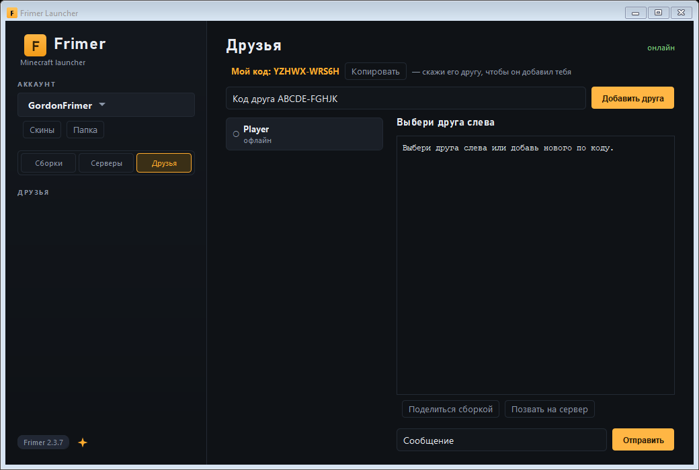
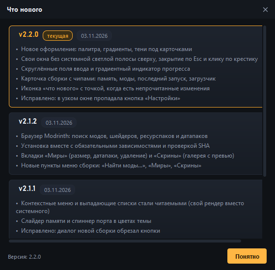
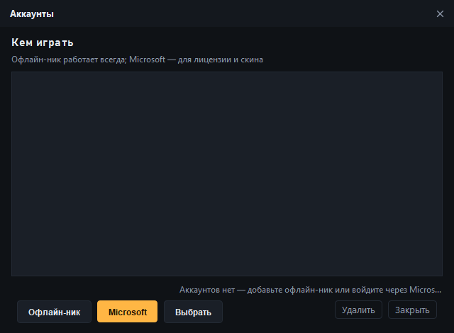
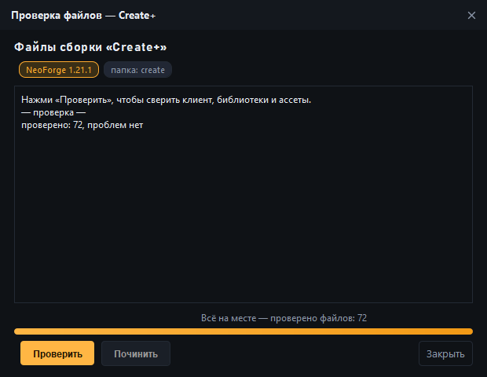
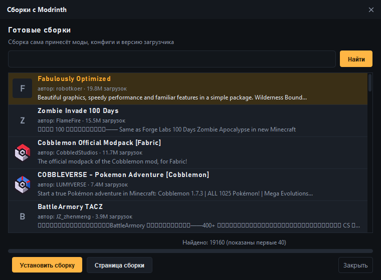
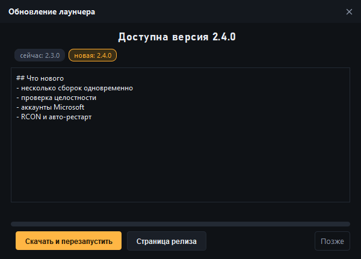

# Frimer Launcher (Java)

Minecraft-лаунчер, переписанный с Python (PyQt6) на **Java + Swing** без единой внешней зависимости.
Запускает Vanilla, Fabric, Quilt, Forge и NeoForge, держит сервера, скины и моды,
сам скачивает нужную версию Java и умеет импортировать сборки Modrinth.

[](https://github.com/Demonhiks/FrimerLaunchers/releases/latest)
[](https://github.com/Demonhiks/FrimerLaunchers/releases/latest)


## Скачать

Готовые сборки собираются автоматически и лежат в разделе
**[Releases](../../releases)**. Java ставить не нужно — она уже внутри.
Установка тоже не нужна: распаковал и запустил, папку можно переносить куда угодно.

| Система | Файл | Что внутри |
|---|---|---|
| Windows x64 | `FrimerLauncher-win64.zip` | `Frimer Launcher.exe` |
| Linux x64 | `FrimerLauncher-linux-x64.tar.gz` | `frimer-launcher/run.sh` |
| macOS Apple Silicon | `FrimerLauncher-macos-arm64.zip` | `Frimer Launcher.app` |
| macOS Intel | `FrimerLauncher-macos-x64.zip` | `Frimer Launcher.app` |

Windows:

```bat
:: распакуйте архив и запустите
Frimer Launcher.exe
```

Linux (архив обычно попадает в `~/Downloads` — сначала перейди туда, где он лежит):

```bash
cd ~/Downloads
tar -xzf FrimerLauncher-linux-x64.tar.gz
./frimer-launcher/run.sh
```

macOS (первый запуск — правый клик по `Frimer Launcher.app` → «Открыть»,
сборка без подписи):

```bash
unzip FrimerLauncher-macos-arm64.zip   # или -x64.zip для Intel
open "Frimer Launcher.app"
```

Постоянная ссылка на последнюю версию:

```text
https://github.com/Demonhiks/FrimerLaunchers/releases/latest/download/FrimerLauncher-win64.zip
```

В релизе рядом лежит и обычный `FrimerLauncher.jar` — если Java 17+ уже стоит:

```bat
java -jar FrimerLauncher.jar
```

Собрать самому из исходников тоже можно — см. «Сборка и запуск» ниже.

## Как пустить друзей на сервер

**playit.gg** — лаунчер подхватывает локальный агент или скачивает его сам и открывает страницу подтверждения. Один клик — и туннель работает; друзьям ставить ничего не нужно.
Адрес для друзей — кнопка «Копировать: …» внизу окна сервера.
## Друзья

Вкладка **«Друзья»** — чат и обмен сборками без аккаунтов, регистрации и серверов.

1. Открой вкладку «Друзья»: лаунчер подключится к брокеру и покажет твой код вида
   `ABCDE-FGHJK` (справа вверху — «онлайн»).
2. Передай код другу любым способом.
3. Друг вводит код в поле «Код друга» и жмёт «Добавить друга». Тебе приходит запрос —
   жми «Принять».
4. Дальше — чат. Кнопка «Поделиться сборкой» отправляет название сборки, версию,
   загрузчик и число модов, а «Позвать на сервер» — адрес твоего сервера.



Сообщения идут через публичный MQTT-брокер, но шифруются AES-GCM ключом, который
выводится из кодов друзей: без кода переписку не прочитать. Код — как пароль,
не выкладывай его публично. Вкладка живёт, пока открыт лаунчер.
## Discord Rich Presence

В профиле Discord видно, во что ты играешь: сборку, загрузчик и версию.

Включается галочкой: **Настройки → Discord Rich Presence → «Показывать активность в Discord»**.
Application ID уже вписан в лаунчер, вводить ничего не нужно.

Нужен запущенный десктоп-клиент Discord. Картинку активности можно загрузить
в том же приложении (Rich Presence → Art Assets).
## Возможности

**Клиент**
- Сборки (инстансы): создание, редактирование, дублирование, удаление, своя иконка и статистика игры.
- Загрузчики: **Vanilla, Fabric, Quilt, Forge, NeoForge** — установка в один клик, с выбором версии загрузчика.
- Автоустановка **Java** (Eclipse Temurin через Adoptium API): JRE/JDK нужного мажора, zip и tar.gz.
- Сборка команды запуска по-честному: правила ОС, `inheritsFrom`, аргументы JVM/игры, `natives`, classpath.
- Импорт сборок **Modrinth (.mrpack)** перетаскиванием файла на окно.
- Браузер **Modrinth**: поиск модов/шейдеров/ресурспаков/датапаков, выбор версии,
  установка с обязательными зависимостями и проверкой SHA.
- **Миры**: размер мира, открытие папки, датапаки с Modrinth, удаление.
- **Скриншоты**: галерея с превью (новые сверху), открытие, копирование в буфер, удаление.
- **Несколько сборок одновременно** — у запущенных плиток загорается зелёная точка.
- **Проверка файлов** сборки (клиент, библиотеки, ассеты) с починкой в один клик.
- **Аккаунты**: несколько офлайн-ников и вход через **Microsoft** (device code; нужен свой Azure client ID).
- **Готовые сборки с Modrinth** — поиск и установка модпака в один клик.
- **Разбор крашей**: причина, подсказки по частым проблемам (RAM, Mixin, Java, драйверы) и текст отчёта.
- Консоль игры прямо в окне, принудительное закрытие процесса вместе с дочерними.
- **Друзья**: код, запросы, статус онлайн, чат, обмен сборками и приглашения на сервер.
- Linux-сборка запускается одной командой `./run.sh` из архива.
- **Discord Rich Presence**: в настройках указывается Application ID, в профиле видно сборку.

**Сервера**
- Ядра: **Paper, Vanilla, Fabric, Forge, NeoForge** — установка через официальные API и инсталляторы.
- `eula.txt` и `server.properties` создаются/обновляются автоматически.
- Живая консоль, «Остановить» (команда `stop`) с автопринудительным завершением через 15 с.
- **playit.gg** подхватывается или скачивается сам, адрес для друзей ловится из лога и копируется в буфер.
- **Метрики** в консоли (TPS, число игроков) и **авто-рестарт** после падения.
- **RCON-консоль**: команды серверу без его окна (пароль генерируется сам).
- **Плагины с Modrinth** прямо из консоли сервера.

**Оформление и мелочи**
- Тёмная и светлая темы, свои скруглённые карточки и бейджи загрузчиков.
- Скины: библиотека, загрузка по нику с Mojang, превью «вид спереди» (Java2D), экспорт в `CustomSkinLoader`.
- Моды: список с названиями и иконками из `fabric.mod.json` / `quilt.mod.json` / `mods.toml`, включение и удаление.
- Свои JSON-парсер и сериализатор, скачивание с докачкой и проверкой SHA-1/SHA-512.
- Иконка **«Что нового»** с точкой-бейджем и журналом изменений по версиям.
- **Свои темы**: JSON с цветами в `~/.frimerlauncher/themes` + кнопка «Экспорт темы».
- **3D-превью скина** с вращением мышью.
- **Автообновление** через GitHub Releases: проверка при старте, скачивание и перезапуск.

| Клиент | Сервера | Моды | Скины |
|---|---|---|---|
|  |  |  |  |

| Браузер Modrinth | Миры | Скриншоты |
|---|---|---|
|  |  |  |

Журнал изменений:



| Аккаунты | Проверка файлов | Сборки Modrinth | Обновление |
|---|---|---|---|
|  |  |  |  |

Светлая тема:

| Светлая тема |

|---|

|  |

## Требования

- **JDK 17 или новее** (`javac` и `java` в PATH). Внешние библиотеки не нужны.
- Windows, Linux или macOS (интерфейс и установщики рассчитаны в первую очередь на Windows).

## Сборка и запуск

Windows:

```bat
build.bat
run.bat
```

Вручную:

```bash
javac -encoding UTF-8 -d build/classes $(find src/main/java -name "*.java")
jar cfe build/FrimerLauncher.jar com.frimer.launcher.Main -C build/classes .
java -jar build/FrimerLauncher.jar
```

Через Maven (если установлен):

```bash
mvn -q package
java -jar target/FrimerLauncher.jar
```

Портативная сборка (`Frimer Launcher.exe` со встроенной Java) — через `jpackage` из JDK 17+:

```bat
mvn -q package
mkdir staging
copy target\FrimerLauncher.jar staging\
jpackage --type app-image --name "Frimer Launcher" --app-version 2.3.3 ^
  --input staging --main-jar FrimerLauncher.jar --main-class com.frimer.launcher.Main ^
  --icon packaging\frimer.ico --dest dist
```

Результат — папка `dist\Frimer Launcher` с `Frimer Launcher.exe`; её и раздаёт CI в архиве.
На Linux тот же вызов даёт `dist/Frimer Launcher/bin/Frimer Launcher` (иконка `packaging/frimer.png`),
на macOS — `dist/Frimer Launcher.app` (иконка `packaging/frimer.icns`).

## Где лежат данные

Данные лежат в `~/.frimerlauncher` (`C:\Users\<имя>\.frimerlauncher`) — сборки, сервера и настройки из Python-версии подхватываются сами. Старая папка `~/.mylauncher` при первом запуске новой версии переименовывается автоматически:

```
~/.frimerlauncher/            (C:\Users\<имя>\.frimerlauncher)
├── instances/            сборки клиента (instance.json, mods/, resourcepacks/, saves/)
├── servers/              сервера (server.json, world/, mods/, plugins/)
├── versions/             версии и профили загрузчиков
├── libraries/  assets/   библиотеки и ресурсы Minecraft
├── runtime/              скачанные JRE/JDK и инсталляторы
├── skins/                библиотека скинов
└── cache/
```

Настройки (ник, тема, память) хранятся в реестре Windows через `java.util.prefs` — раздел `com/frimer/launcher`.

## Структура проекта

```
src/main/java/com/frimer/launcher/
├── Main.java                 точка входа
├── core/                     вся логика без UI
│   ├── Json, Utils, Dirs, Http, Downloader, Archives
│   ├── Mojang, Loaders, Rules, LaunchBuilder
│   ├── JavaProvisioner, VanillaInstaller, FabricInstaller, ForgeInstaller
│   ├── Instance, InstanceStore, ModpackImporter, ModFiles
│   ├── Modrinth (поиск и установка с зависимостями)
│   ├── ServerInstance, ServerStore, ServerInstallers, ServerRunner, Playit
│   ├── Skins, SkinRenderer, CrashAnalyzer, GameLauncher, AppSettings
└── ui/                       Swing-интерфейс
    ├── Theme, Ui, MainFrame, InstanceTile
    ├── WorldsDialog, ScreenshotsDialog, ModrinthDialog, WrapPanel
    └── диалоги: сборка, настройки, сервер, консоль, моды, скины, краш
tools/                        служебные утилиты разработчика
├── SmokeTest.java            проверка ядра без GUI (JSON, UUID, сеть Mojang, Forge, скин)
├── TestModrinth.java         поиск и установка мода с Modrinth в временную папку
└── UiShots.java              рендер всех окон в build/ui (проверка вёрстки)
legacy/launcher.py            исходная Python-версия для сверки поведения
packaging/frimer.ico          значок приложения для jpackage
```

## Что перенесено, а что нет

Перенесено полностью: запуск всех пяти вариантов игры, установка версий и загрузчиков,
Java, сборка аргументов, сборки/инстансы, сервера и их консоль, playit.gg, скины,
метаданные модов, импорт `.mrpack`, разбор крашей, темы, настройки.

Пока **не** перенесено: Discord Rich Presence (в Python-версии `DISCORD_CLIENT_ID` был пустым),
CurseForge (нужен API-ключ), анализатор производительности с графиками, ИИ-починка крашей
(модуль `ai_fixer.py` отсутствует), автообновление (`UPDATE_MANIFEST_URL` был пустым)
и анимация сплэша.

## Разработка

```bash
# проверить ядро (нужна сеть для части проверок)
javac -cp build/classes -d build/test tools/SmokeTest.java
java -cp "build/classes;build/test" SmokeTest

# отрендерить все окна в PNG
javac -cp build/classes -d build/test tools/UiShots.java
java -cp "build/classes;build/test" UiShots
```

## Дисклеймер

Проект не связан с Mojang Studios и Microsoft. Minecraft — товарный знак Mojang Synergies AB.
Лаунчер работает в офлайн-режиме (`online-mode=false`, офлайн-UUID), лицензия игры не проверяется
и не требуется. Используй на свой риск.

## Лицензия

MIT — см. [LICENSE](LICENSE).
